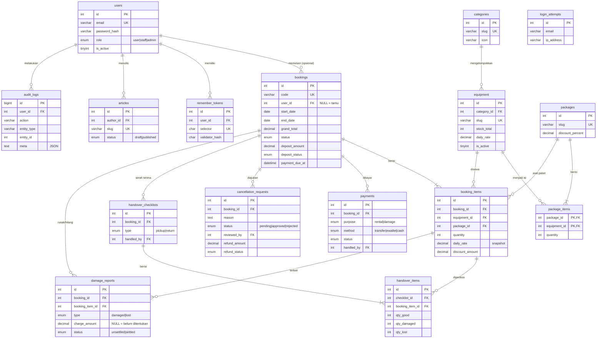

# Rancangan Database CampGear

Database relasional MySQL/MariaDB (InnoDB, `utf8mb4_unicode_ci`) dengan 16 tabel. Integritas dijaga oleh foreign key, `UNIQUE`, dan `CHECK` constraint. Seluruh query aplikasi memakai prepared statement MySQLi.

## File SQL

| File | Isi | Kapan dijalankan |
|---|---|---|
| `database/schema.sql` | Struktur 16 tabel. **Menghapus tabel lama** sebelum membuat ulang | Instalasi baru |
| `database/seed.sql` | 3 akun demo, 6 kategori, 15 alat, 3 paket | Instalasi baru, setelah schema |
| `database/seed_articles.sql` | 4 artikel informatif; idempoten (`WHERE NOT EXISTS`) | Instalasi baru, atau ditambahkan ke database yang sudah ada |
| `database/demo_data.sql` | ±195 booking contoh (6 bulan, semua status) dengan tanggal relatif `CURDATE()` | Opsional, hanya pada database baru (untuk grafik & demo) |
| `database/setup.php` | Menjalankan file di atas lewat CLI | Pengembangan lokal |
| `database/tools/generate-demo.php` | Pembuat `demo_data.sql` | Bila data demo perlu dibuat ulang |

## Diagram Relasi (ERD)

## Kamus Data Ringkas

| Tabel | Fungsi | Catatan desain |
|---|---|---|
| `users` | Akun semua role | Email unik; password bcrypt (`password_hash`); `is_active` untuk menonaktifkan tanpa menghapus |
| `remember_tokens` | Token "Ingat saya" | Hanya hash SHA-256 validator yang disimpan; token dirotasi setiap dipakai |
| `login_attempts` | Pembatas brute-force login & cek booking | Dibersihkan otomatis setelah 1 hari |
| `categories` | Kategori alat | Slug unik untuk URL; tidak bisa dihapus bila berisi alat |
| `equipment` | Alat camping | `stock_total` = unit fisik dimiliki; ketersediaan per tanggal dihitung, tidak disimpan |
| `packages`, `package_items` | Paket sewa | Diskon persentase 0–100 (`CHECK`) |
| `bookings` | Transaksi sewa | `user_id` NULL untuk tamu; status ENUM; tanggal tiap tahap; deposit administratif |
| `booking_items` | Rincian alat per booking | Tarif disalin (snapshot) agar perubahan tarif tidak mengubah transaksi lama |
| `payments` | Pembayaran simulasi | `purpose` membedakan sewa dan penggantian; `handled_by` untuk tunai |
| `cancellation_requests` | Pengajuan pembatalan | Terpisah dari booking agar riwayat, peninjau, dan catatan refund tersimpan |
| `handover_checklists`, `handover_items` | Checklist serah terima | Satu checklist per jenis per booking (`UNIQUE booking_id, type`) |
| `damage_reports` | Kerusakan/kehilangan | Nominal opsional; `unsettled` memblokir penyelesaian booking |
| `articles` | Artikel | `published_at` diisi saat pertama kali terbit |
| `audit_logs` | Catatan tindakan Staff/Admin | `meta` berisi JSON detail perubahan |

## Mengapa Stok Tidak Disimpan sebagai "Sisa Stok"

Ketersediaan selalu dihitung dari booking yang statusnya menahan stok (`pending_payment` yang belum lewat batas bayar, `confirmed`, `picked_up`). Dengan cara ini:

- pembatalan, kedaluwarsa, dan pengembalian otomatis melepas stok tanpa perlu memperbarui kolom lain;
- tidak ada risiko angka "sisa stok" tidak sinkron dengan transaksi;
- ketersediaan bisa dihitung untuk tanggal mana pun.

Indeks `idx_bookings_status_dates (status, start_date, end_date)` dan `idx_booking_items_equipment` mendukung query ketersediaan.

## Memperbarui Database yang Sudah Ada

`schema.sql` menghapus tabel. Untuk database yang datanya ingin dipertahankan, **jangan** menjalankan `schema.sql`/`seed.sql` ulang. Tambahan artikel awal dapat diimpor dengan aman lewat `seed_articles.sql` (tidak menghapus data dan tidak menggandakan artikel yang sudah ada).
