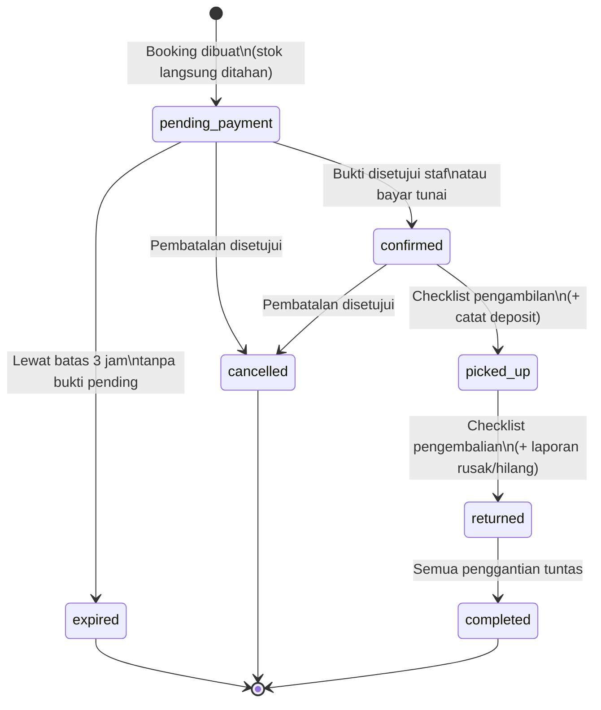
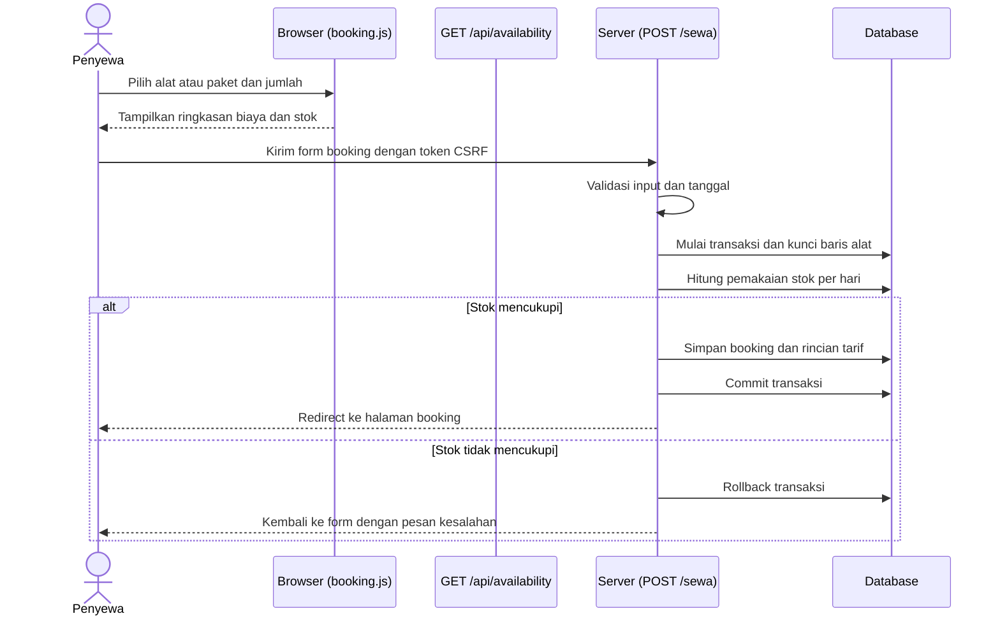
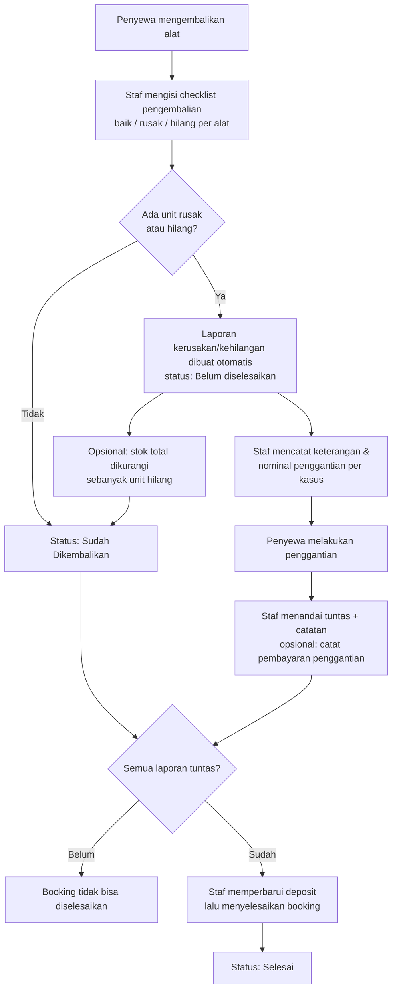
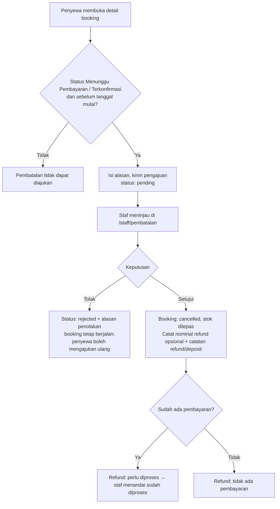

# Dokumentasi Proses Bisnis CampGear

CampGear adalah aplikasi manajemen reservasi persewaan alat camping. Dokumen ini menjelaskan aktor, kebutuhan, alur proses, status, dan aturan bisnis yang diterapkan di aplikasi.

## 1. Aktor dan Hak Akses

| Aktor                 | Cara masuk                | Hak akses utama                                                                                                                                                                                       |
| --------------------- | ------------------------- | ----------------------------------------------------------------------------------------------------------------------------------------------------------------------------------------------------- |
| **Pengunjung (tamu)** | Tanpa login               | Melihat katalog, paket, artikel, statistik, cara reservasi, kontak; membuat booking; cek status booking dengan kode + email/HP; membayar via transfer/e-wallet dengan upload bukti privat atau tunai di lokasi; melihat bukti pembayaran privat; mengajukan pembatalan; melihat kartu pengambilan |
| **User (pelanggan)**  | Registrasi + login        | Semua hak pengunjung, ditambah riwayat penyewaan, status pembatalan, dan pengelolaan data pribadi (profil & password)                                                                                 |
| **Staff**             | Login (akun dibuat Admin) | Dashboard operasional; kelola booking (verifikasi bukti transfer/e-wallet, penerimaan tunai, pengambilan, pengembalian, deposit, penyelesaian); meninjau pembatalan; mengelola kerusakan/kehilangan; CRUD alat, kategori, paket, artikel  |
| **Admin**             | Login                     | Semua hak Staff, ditambah manajemen akun (Admin, Staff, User) dan melihat catatan tindakan Staff (log aktivitas)                                                                                      |

Proteksi rute dilakukan oleh middleware router: `auth` (harus login), `guest` (hanya tamu), `role:staff,admin`, dan `role:admin`. Pengunjung yang membuka rute terlarang diarahkan ke halaman login (HTTP 302); pengguna yang login dengan role tidak sesuai mendapat HTTP 403.

## 2. Pemetaan Kebutuhan ke Fitur

| Kebutuhan dari brief                                                               | Implementasi                                                                                               | Lokasi                                                                  |
| ---------------------------------------------------------------------------------- | ---------------------------------------------------------------------------------------------------------- | ----------------------------------------------------------------------- |
| Info alat, paket, cara reservasi, kontak                                           | Halaman katalog (chip kategori, cari, quick view), detail alat, paket, cara reservasi, kontak + FAQ        | `/alat`, `/paket`, `/cara-reservasi`, `/kontak`                         |
| Pilih alat, tanggal, jumlah unit, data kontak                                      | Form booking interaktif empat langkah dalam mode fokus (alat satuan + paket)                               | `/sewa`                                                                 |
| Validasi stok per rentang tanggal                                                  | Perhitungan stok per hari + transaksi berkunci                                                             | `App\Models\Availability`, `Booking::create()`, `GET /api/availability` |
| Minimal 3 artikel                                                                  | 4 artikel terbit + CRUD artikel                                                                            | `/artikel`, `/staff/artikel`                                            |
| Cek status dengan kode + email/telepon                                             | Form cek booking dengan pembatas percobaan                                                                 | `/cek-booking`                                                          |
| Status confirmed → kartu pengambilan, QR, checklist                                | Tiket ekspedisi: QR tampil setelah Terkonfirmasi, kartu pengambilan + checklist serah terima, bisa dicetak | `/booking/{kode}`                                                       |
| Pembatalan dengan alasan, status pending/approved/rejected                         | Pengajuan oleh penyewa, ditinjau staf                                                                      | `/booking/{kode}` → `/staff/pembatalan`                                 |
| Grafik penyewaan, pembatalan, pemakaian stok                                       | Chart.js via `GET /api/stats`, bulanan/mingguan                                                            | `/statistik`, dashboard staff                                           |
| Registrasi & login email + password                                                | Registrasi, login, logout, "Ingat saya"                                                                    | `/register`, `/login`                                                   |
| Riwayat, status pembatalan, data pribadi                                           | Halaman akun + profil & ganti password                                                                     | `/akun`, `/akun/profil`                                                 |
| Dashboard staff (hari ini, pembatalan menunggu, pendapatan lunas, tabel transaksi) | Kartu ringkasan, agenda hari ini, grafik, tabel transaksi terbaru                                          | `/staff`                                                                |
| Terima/tolak pembatalan; approved → cancelled, stok lepas, catatan refund/deposit  | Halaman tinjau pembatalan                                                                                  | `/staff/pembatalan/{id}`                                                |
| CRUD artikel                                                                       | Tulis, ubah, terbitkan/draf, hapus, upload sampul                                                          | `/staff/artikel`                                                        |
| CRUD alat, kategori, stok total, tarif harian                                      | CRUD alat (dengan gambar), kategori, paket                                                                 | `/staff/alat`, `/staff/kategori`, `/staff/paket`                        |
| Manajemen akun Admin/Staff/User                                                    | Tambah, ubah role/status, atur ulang password, hapus (dengan pengaman)                                     | `/admin/pengguna`                                                       |
| Catatan tindakan Staff                                                             | Log aktivitas otomatis + filter                                                                            | `/admin/log`                                                            |
| Pencatatan kerusakan/kehilangan dan kewajiban penggantian                          | Checklist pengembalian → laporan kerusakan/kehilangan → penyelesaian                                       | `/staff/booking/{kode}`, `/staff/kerusakan`                             |
| Pembayaran transfer/e-wallet (upload bukti) & tunai | Pelanggan mengunggah bukti bayar privat; staf memverifikasi (setujui/tolak) atau menerima tunai di lokasi | `/booking/{kode}/bayar`, `/booking/{kode}/bukti/{id}`, `/staff/booking/{kode}/pembayaran/{id}/*` |
| Responsive, keamanan dasar                                                         | Bootstrap 5; hashing, validasi, CSRF, proteksi rute                                                        | seluruh aplikasi                                                        |

## 3. Siklus Status Booking

| Status            | Label di aplikasi   | Menahan stok?                      | Keterangan                                       |
| ----------------- | ------------------- | ---------------------------------- | ------------------------------------------------ |
| `pending_payment` | Menunggu Pembayaran | Ya, selama belum lewat batas bayar atau ada bukti pending | Batas bayar awal 3 jam. Jika bukti diunggah tepat waktu (sebelum deadline), stok tetap ditahan selama menunggu verifikasi staf meskipun melewati deadline. Perlu dibedakan: bukti yang diunggah tepat waktu hanya mempertahankan status `pending_payment` dan retensi stok; status transaksi belum menjadi `confirmed` hingga staf memberikan persetujuan |
| `confirmed`       | Terkonfirmasi       | Ya                                 | QR di tiket + kartu pengambilan tersedia (pembayaran telah disetujui staf atau dibayar tunai) |
| `picked_up`       | Sedang Disewa       | Ya                                 | Alat di tangan penyewa                           |
| `returned`        | Sudah Dikembalikan  | Tidak                              | Menunggu penyelesaian (dan penggantian bila ada) |
| `completed`       | Selesai             | Tidak                              | Akhir alur normal                                |
| `cancelled`       | Dibatalkan          | Tidak                              | Hanya lewat pembatalan yang disetujui            |
| `expired`         | Kedaluwarsa         | Tidak                              | Tidak dibayar sebelum deadline, atau bukti ditolak setelah batas waktu habis |

Kedaluwarsa dijalankan secara _lazy_ (`Booking::expireOverdue()`) setiap kali data booking atau ketersediaan stok dibaca, bukan melalui cron job atau eksekusi tepat pada detik deadline. Booking yang tidak memiliki bukti pembayaran `pending` yang diunggah tepat waktu akan ditandai kedaluwarsa (`expired`) dan stoknya dilepaskan ketika sistem menjalankan pemeriksaan data tersebut. Aturan kedaluwarsa dan perhitungan ketersediaan stok (`Availability::forRange()`) mengecualikan booking `pending_payment` yang memiliki bukti pembayaran berstatus `pending` yang diunggah tepat waktu sebelum deadline, meskipun waktu `payment_due_at` sudah terlampaui. Perlu ditegaskan bahwa pengunggahan bukti tepat waktu ini berbeda dengan pembayaran yang sudah disetujui: booking tetap berstatus `pending_payment` dan tiket belum terkonfirmasi, namun stoknya tetap ditahan selama peninjauan staf berlangsung. Jika bukti ditolak setelah deadline terlewati, booking juga akan kedaluwarsa dan stoknya dilepaskan pada pemeriksaan sistem berikutnya.

## 4. Alur Proses

### 4.1 Booking dan validasi stok

**Perhitungan stok per hari.** Untuk setiap alat dan setiap tanggal dalam rentang sewa, sistem menjumlahkan unit yang dipakai booking aktif pada tanggal itu. Unit tersedia = stok total − pemakaian tertinggi di salah satu hari. Contoh: stok 5, booking A tanggal 10–12 dan booking B tanggal 14–15 masing-masing 3 unit. Untuk permintaan tanggal 10–15, puncak pemakaian 3 sehingga tersedia 2 unit (bukan −1 seperti bila A dan B dijumlah langsung).

**Mencegah double booking.** Pengecekan stok dan penyimpanan berada dalam satu transaksi. Baris alat yang dipesan dikunci dengan `SELECT ... FOR UPDATE`, sehingga permintaan lain untuk alat yang sama menunggu hingga transaksi pertama selesai dan menghitung ulang dengan data terbaru. Pengujian dua proses paralel yang memperebutkan stok terakhir pada 40 tanggal menghasilkan 0 overbooking (tanpa kunci: 40 overbooking).

**Paket.** Paket dipecah menjadi alat-alatnya. Kebutuhan dari paket digabung dengan alat satuan yang sama sebelum dicek. Diskon paket dihitung per baris alat dan disimpan sebagai `discount_amount`.

### 4.2 Pembayaran dan cek status

1. Setelah booking dibuat, penyewa mendapat **kode booking** (mis. `CG261118-7KQ2`) dan batas waktu pembayaran **3 jam** (`payment_window_hours = 3`).
2. **Alur pembayaran transfer / e-wallet:**
   - Penyewa memilih metode transfer atau e-wallet pada tiket booking. Nomor rekening atau barcode QR resmi ditampilkan sesuai konfigurasi usaha.
   - Penyewa mengunggah berkas bukti pembayaran (format JPG/PNG/WEBP, maksimal 2 MB) melalui form `POST /booking/{code}/bayar` dengan `enctype="multipart/form-data"`. Validasi MIME dilakukan langsung dari isi berkas (`finfo`).
   - Berkas disimpan secara privat di folder `storage/payments/` (`Upload::privateImage()`) yang berada di luar folder `public/`, dan akses HTTP langsung ke folder tersebut diblokir oleh aturan `.htaccess` (`RewriteRule` root dan `Deny from all`). Catatan pembayaran baru tersimpan di tabel `payments` dengan `purpose = 'rental'`, `status = 'pending'`, dan nama berkas `proof_image`. Jika penyimpanan database gagal, berkas baru otomatis dihapus lewat `Upload::deletePrivate()` agar tidak menjadi berkas sampah, tanpa mengganggu riwayat bukti lama.
   - Selama status verifikasi menunggu (`pending`), tiket ekspedisi menampilkan pesan "Menunggu Verifikasi" dan tautan pratinjau bukti privat (`GET /booking/{code}/bukti/{payment_id}`).
   - Stok sewa tetap aman dan ditahan oleh sistem (`Availability`), terlindungi dari proses kedaluwarsa meskipun waktu 3 jam terlampaui saat menunggu keputusan staf.
3. **Verifikasi staf:**
   - Staf membuka detail booking dan memeriksa bukti melalui endpoint privat staf (`GET /staff/booking/{code}/bukti/{payment_id}`).
   - **Persetujuan (Approval):** Staf menekan tombol *Setujui Pembayaran* (`POST /staff/booking/{code}/pembayaran/{id}/setujui`). Status pembayaran berubah menjadi `paid`, `paid_at = NOW()`, `handled_by` diisi staf yang memproses, dan status booking resmi menjadi **Terkonfirmasi** (`confirmed`). Tiket menampilkan QR kode booking dan kartu pengambilan alat aktif.
   - **Penolakan (Rejection):** Staf menekan tombol *Tolak Pembayaran* (`POST /staff/booking/{code}/pembayaran/{id}/tolak`) dan wajib mengisi alasan penolakan melalui modal dialog. Status pembayaran berubah menjadi `failed`, alasan dicatat pada kolom `note`, dan dicatat ke `audit_logs` dengan aksi `booking.payment_rejected`. Waktu penolakan (`rejected_at`) ditampilkan di antarmuka riwayat staf berdasarkan timestamp `audit_logs.created_at` yang dicocokkan melalui `meta.payment_id`, bukan timestamp transaksi penolakan yang disimpan di tabel payments (karena skema tabel payments tidak memiliki kolom `rejected_at`).
   - **Unggah Ulang & Kedaluwarsa:**
     - Jika bukti ditolak sebelum deadline 3 jam berakhir, penyewa dapat melihat alasan penolakan staf dan diperbolehkan mengunggah ulang bukti baru hingga batas waktu asli habis.
     - Jika bukti ditolak setelah batas waktu 3 jam terlewati (atau penyewa tidak mengunggah bukti perbaikan hingga deadline habis), booking akan beralih menjadi **Kedaluwarsa** (`expired`) dan stoknya dilepaskan ketika sistem menjalankan pemeriksaan booking atau ketersediaan stok berikutnya (*lazy expiration*).
4. **Pembayaran tunai:**
   - Penyewa yang membayar langsung di lokasi dilayani staf melalui tombol *Terima tunai* (`POST /staff/booking/{code}/bayar`). Sistem mencatat pembayaran dengan `method = 'cash'`, `status = 'paid'`, dan booking langsung berstatus `confirmed`.
5. **Cek status:**
   - Status bisa dicek kapan saja di `/cek-booking` dengan kode booking + email atau nomor HP. Percobaan dibatasi oleh rate limiter berbasis database, dan pesan kesalahan diseragamkan untuk mencegah penebakan kode booking.

### 4.3 Pengambilan alat (serah terima)

1. Penyewa datang pada rentang tanggal sewa dan menunjukkan tiket (QR) atau kartu pengambilan yang dicetak.
2. Staf membuka booking, memeriksa setiap alat bersama penyewa, dan mengisi checklist: jumlah **baik** dan **cacat** per alat (harus sama dengan jumlah disewa).
3. Staf dapat mencatat **deposit** (nominal opsional + catatan, mis. "KTP ditahan").
4. Status menjadi **Sedang Disewa**.

Pengambilan ditolak bila booking belum dibayar, sebelum tanggal mulai, atau setelah periode sewa berakhir.

### 4.4 Pengembalian, kerusakan, dan kehilangan

### 4.5 Pembatalan

Hanya ada satu pengajuan `pending` per booking. Pengajuan dan peninjauan menggunakan transaksi dengan kunci baris, sehingga dua pengajuan atau dua persetujuan bersamaan tidak sama-sama lolos.

### 4.6 Pengelolaan inventaris dan konten

- **Alat:** kategori, nama, deskripsi, stok total, tarif harian, gambar, status aktif. Stok total tidak bisa diturunkan di bawah pemakaian tertinggi booking mendatang. Alat yang pernah disewa atau menjadi isi paket tidak bisa dihapus (dinonaktifkan saja) agar riwayat transaksi utuh.
- **Kategori:** tidak bisa dihapus selama masih berisi alat.
- **Paket:** isi alat + diskon persentase; paket yang pernah dipesan tidak bisa dihapus.
- **Artikel:** draf atau terbit; tanggal terbit diisi saat pertama kali diterbitkan.
- Perubahan tarif atau isi paket hanya berlaku untuk booking baru, karena booking menyimpan snapshot tarif.

### 4.7 Manajemen akun dan audit (Admin)

- Admin dapat membuat akun dengan role Admin/Staff/User, mengubah data, role, dan status aktif, serta mengatur ulang password.
- Pengaman: admin tidak bisa menurunkan role, menonaktifkan, atau menghapus dirinya sendiri; admin aktif terakhir tidak bisa dihilangkan; akun yang memiliki booking atau catatan aktivitas tidak dihapus (cukup dinonaktifkan).
- Akun nonaktif langsung tidak bisa memakai sesinya, karena data pengguna dibaca ulang setiap request. Token "Ingat saya" milik akun tersebut dihapus.
- **Invalidasi sesi pada pergantian/reset password:** saat pengguna mengganti password sendiri (`AccountController::updatePassword()`) atau di-reset oleh Admin (`Admin\UserController::resetPassword()`), seluruh token "Ingat saya" milik akun tersebut dicabut dari database (`RememberToken::deleteForUser()`). Sesi aktif pengguna di peramban/perangkat lain tidak di-push secara real-time, melainkan otomatis tertolak pada request berikutnya saat evaluasi tanda tangan hash password (`$_SESSION['password_sig']`) gagal cocok (`hash_equals()`).
- Setiap tindakan Staff/Admin yang mengubah data dicatat di `audit_logs` (pelaku, aksi, objek, keterangan, detail JSON, IP, waktu) dan dapat difilter di `/admin/log`.

## 5. Aturan Bisnis

| Aturan               | Nilai                                                                                                                                         |
| -------------------- | --------------------------------------------------------------------------------------------------------------------------------------------- |
| Durasi sewa          | Per hari, inklusif tanggal mulai dan selesai; maksimal **14 hari**                                                                            |
| Rentang pemesanan    | Hari ini sampai H+90                                                                                                                          |
| Batas pembayaran     | **3 jam**; lewat batas tanpa bukti pending → kedaluwarsa, stok dilepas                                                                        |
| Total pembayaran     | Biaya sewa setelah diskon paket (deposit tidak termasuk)                                                                                      |
| Pembatalan           | Sebelum tanggal mulai, untuk booking Menunggu Pembayaran/Terkonfirmasi; status pending → approved/rejected                                    |
| Refund               | **Tidak dihitung otomatis.** Staf mencatat nominal (opsional, tidak melebihi yang dibayar) dan catatan                                        |
| Deposit              | **Tidak dihitung otomatis.** Staf mencatat nominal, status (belum dicatat/ditahan/dikembalikan), dan catatan                                  |
| Kerusakan/kehilangan | Penyewa wajib melakukan penggantian. Nominal dan bentuk penggantian dicatat staf per kasus; booking baru selesai setelah semua laporan tuntas |
| Pembayaran           | Upload bukti transfer/e-wallet diverifikasi staf secara manual; pembayaran tunai dicatat staf di kasir                                        |

Nominal deposit dan biaya penggantian sengaja belum ditetapkan dan menunggu keputusan pemilik usaha.

## 6. Statistik

| Grafik                    | Definisi                                                                                                           |
| ------------------------- | ------------------------------------------------------------------------------------------------------------------ |
| Penyewaan per periode     | Jumlah booking berstatus Terkonfirmasi/Sedang Disewa/Dikembalikan/Selesai, menurut bulan atau minggu tanggal mulai |
| Pengajuan pembatalan      | Jumlah pengajuan per status (disetujui, ditolak, menunggu), menurut tanggal pengajuan                              |
| Tingkat pemakaian stok    | Unit-hari tersewa ÷ (stok total alat aktif × jumlah hari) × 100%, per periode dan per kategori                     |
| Pendapatan (khusus staff) | Jumlah pembayaran terverifikasi berstatus lunas (sewa + penggantian), menurut tanggal bayar                        |

Grafik publik tidak memuat data pribadi maupun pendapatan. Setiap grafik menyediakan tampilan tabel sebagai alternatif aksesibel.
