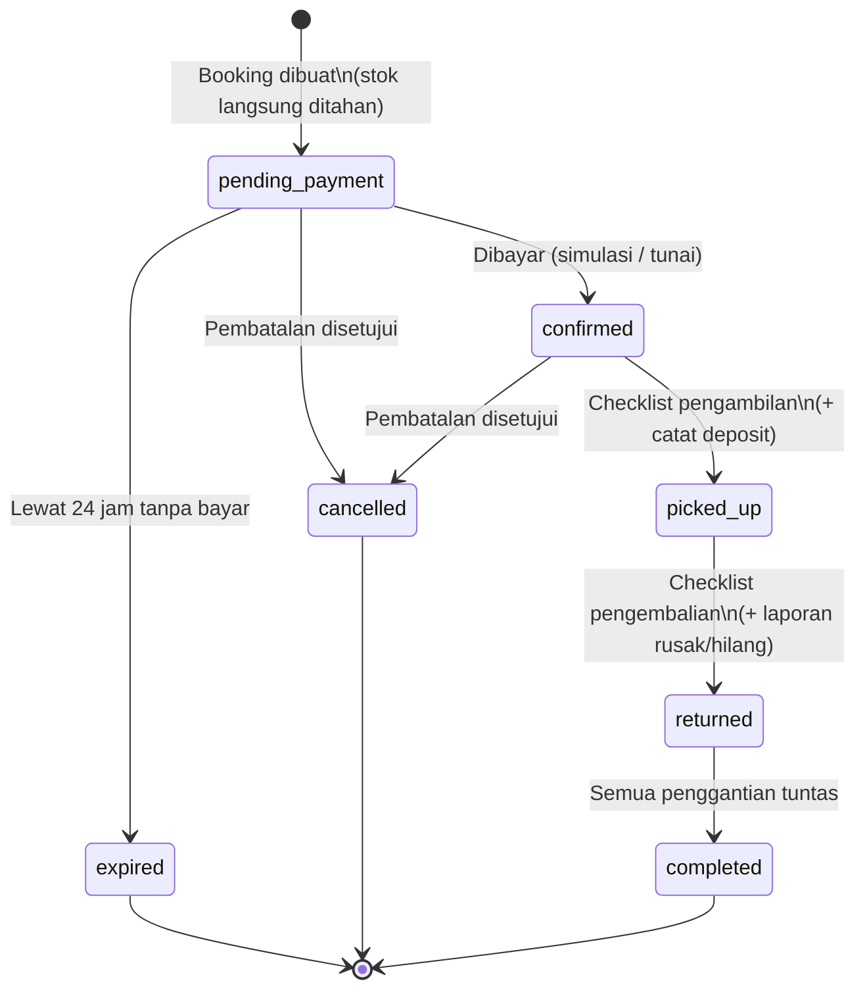
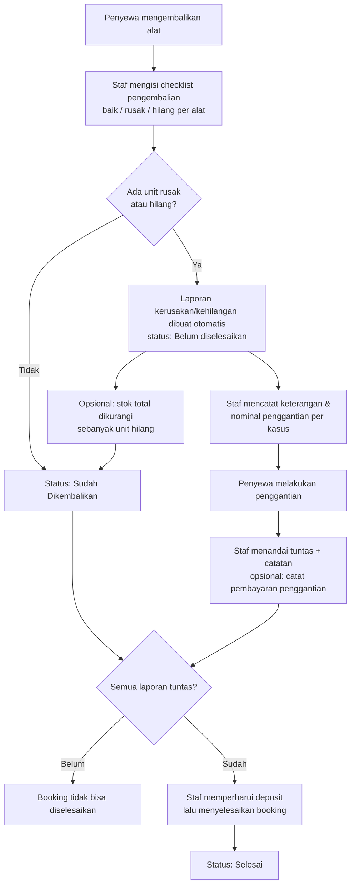
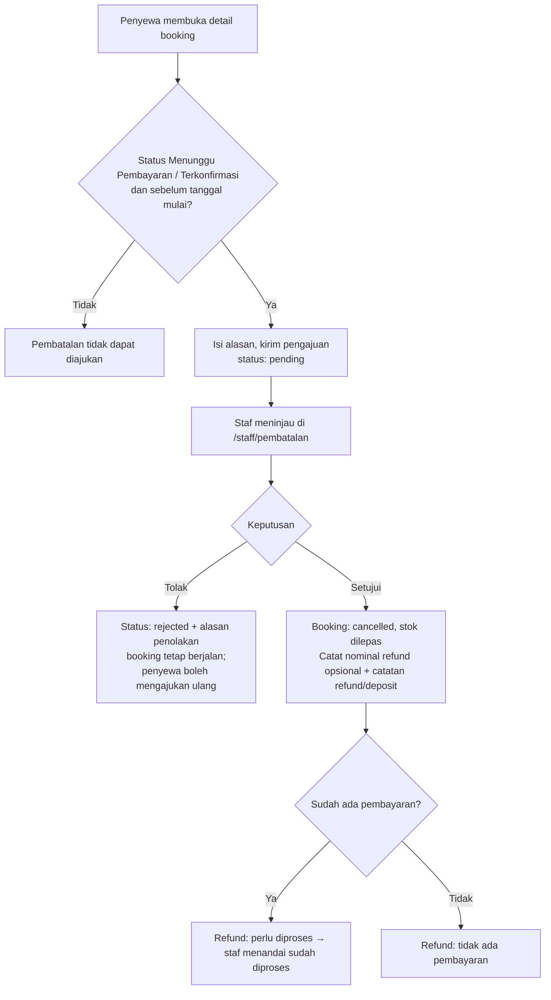

# Dokumentasi Proses Bisnis CampGear

CampGear adalah aplikasi manajemen reservasi persewaan alat camping. Dokumen ini menjelaskan aktor, kebutuhan, alur proses, status, dan aturan bisnis yang diterapkan di aplikasi.

## 1. Aktor dan Hak Akses

| Aktor | Cara masuk | Hak akses utama |
|---|---|---|
| **Pengunjung (tamu)** | Tanpa login | Melihat katalog, paket, artikel, statistik, cara reservasi, kontak; membuat booking; cek status booking dengan kode + email/HP; membayar (simulasi); mengajukan pembatalan; melihat kartu pengambilan |
| **User (pelanggan)** | Registrasi + login | Semua hak pengunjung, ditambah riwayat penyewaan, status pembatalan, dan pengelolaan data pribadi (profil & password) |
| **Staff** | Login (akun dibuat Admin) | Dashboard operasional; kelola booking (pembayaran tunai, pengambilan, pengembalian, deposit, penyelesaian); meninjau pembatalan; mengelola kerusakan/kehilangan; CRUD alat, kategori, paket, artikel |
| **Admin** | Login | Semua hak Staff, ditambah manajemen akun (Admin, Staff, User) dan melihat catatan tindakan Staff (log aktivitas) |

Proteksi rute dilakukan oleh middleware router: `auth` (harus login), `guest` (hanya tamu), `role:staff,admin`, dan `role:admin`. Pengunjung yang membuka rute terlarang diarahkan ke halaman login (HTTP 302); pengguna yang login dengan role tidak sesuai mendapat HTTP 403.

## 2. Pemetaan Kebutuhan ke Fitur

| Kebutuhan dari brief | Implementasi | Lokasi |
|---|---|---|
| Info alat, paket, cara reservasi, kontak | Halaman katalog (chip kategori, cari, quick view), detail alat, paket, cara reservasi, kontak + FAQ | `/alat`, `/paket`, `/cara-reservasi`, `/kontak` |
| Pilih alat, tanggal, jumlah unit, data kontak | Form booking interaktif empat langkah dalam mode fokus (alat satuan + paket) | `/sewa` |
| Validasi stok per rentang tanggal | Perhitungan stok per hari + transaksi berkunci | `App\Models\Availability`, `Booking::create()`, `GET /api/availability` |
| Minimal 3 artikel | 4 artikel terbit + CRUD artikel | `/artikel`, `/staff/artikel` |
| Cek status dengan kode + email/telepon | Form cek booking dengan pembatas percobaan | `/cek-booking` |
| Status confirmed → kartu pengambilan, QR, checklist | Tiket ekspedisi: QR tampil setelah Terkonfirmasi, kartu pengambilan + checklist serah terima, bisa dicetak | `/booking/{kode}` |
| Pembatalan dengan alasan, status pending/approved/rejected | Pengajuan oleh penyewa, ditinjau staf | `/booking/{kode}` → `/staff/pembatalan` |
| Grafik penyewaan, pembatalan, pemakaian stok | Chart.js via `GET /api/stats`, bulanan/mingguan | `/statistik`, dashboard staff |
| Registrasi & login email + password | Registrasi, login, logout, "Ingat saya" | `/register`, `/login` |
| Riwayat, status pembatalan, data pribadi | Halaman akun + profil & ganti password | `/akun`, `/akun/profil` |
| Dashboard staff (hari ini, pembatalan menunggu, pendapatan dummy, tabel transaksi) | Kartu ringkasan, agenda hari ini, grafik, tabel transaksi terbaru | `/staff` |
| Terima/tolak pembatalan; approved → cancelled, stok lepas, catatan refund/deposit | Halaman tinjau pembatalan | `/staff/pembatalan/{id}` |
| CRUD artikel | Tulis, ubah, terbitkan/draf, hapus, upload sampul | `/staff/artikel` |
| CRUD alat, kategori, stok total, tarif harian | CRUD alat (dengan gambar), kategori, paket | `/staff/alat`, `/staff/kategori`, `/staff/paket` |
| Manajemen akun Admin/Staff/User | Tambah, ubah role/status, atur ulang password, hapus (dengan pengaman) | `/admin/pengguna` |
| Catatan tindakan Staff | Log aktivitas otomatis + filter | `/admin/log` |
| Pencatatan kerusakan/kehilangan dan kewajiban penggantian | Checklist pengembalian → laporan kerusakan/kehilangan → penyelesaian | `/staff/booking/{kode}`, `/staff/kerusakan` |
| Pembayaran sandbox/dummy | Pembayaran simulasi transfer/e-wallet; tunai oleh staf | `/booking/{kode}/bayar` |
| Responsive, keamanan dasar | Bootstrap 5; hashing, validasi, CSRF, proteksi rute | seluruh aplikasi |

## 3. Siklus Status Booking



| Status | Label di aplikasi | Menahan stok? | Keterangan |
|---|---|---|---|
| `pending_payment` | Menunggu Pembayaran | Ya, selama belum lewat batas bayar | Batas bayar 24 jam |
| `confirmed` | Terkonfirmasi | Ya | QR di tiket + kartu pengambilan tersedia |
| `picked_up` | Sedang Disewa | Ya | Alat di tangan penyewa |
| `returned` | Sudah Dikembalikan | Tidak | Menunggu penyelesaian (dan penggantian bila ada) |
| `completed` | Selesai | Tidak | Akhir alur normal |
| `cancelled` | Dibatalkan | Tidak | Hanya lewat pembatalan yang disetujui |
| `expired` | Kedaluwarsa | Tidak | Tidak dibayar sampai batas waktu |

Kedaluwarsa dijalankan secara *lazy* (`Booking::expireOverdue()`) setiap kali data booking atau stok dibaca, karena hosting gratis tidak menyediakan cron. Selain itu, perhitungan stok selalu mengabaikan booking `pending_payment` yang sudah lewat batas bayar, sehingga stok terlepas tepat waktu meskipun status belum diperbarui.

## 4. Alur Proses

### 4.1 Booking dan validasi stok

```mermaid
sequenceDiagram
    actor P as Penyewa
    participant B as Browser (booking.js)
    participant API as GET /api/availability
    participant S as Server (POST /sewa)
    participant DB as Database

    P->>B: Pilih tanggal mulai & selesai
    B->>API: fetch(start, end)
    API->>DB: Booking aktif yang beririsan tanggal
    API-->>B: Sisa unit per alat & set per paket (JSON)
    P->>B: Pilih alat/paket & jumlah, isi kontak
    B-->>P: Ringkasan biaya, tanda kekurangan stok
    P->>S: Kirim form (token CSRF)
    S->>S: Validasi input & aturan tanggal
    S->>DB: BEGIN; SELECT alat ... FOR UPDATE
    S->>DB: Hitung pemakaian per hari
    alt stok cukup
        S->>DB: INSERT booking + rincian (tarif snapshot); COMMIT
        S-->>P: Redirect ke /booking/{kode}
    else stok kurang
        S->>DB: ROLLBACK
        S-->>P: Kembali ke form + pesan alat yang kurang
    end
```

**Perhitungan stok per hari.** Untuk setiap alat dan setiap tanggal dalam rentang sewa, sistem menjumlahkan unit yang dipakai booking aktif pada tanggal itu. Unit tersedia = stok total − pemakaian tertinggi di salah satu hari. Contoh: stok 5, booking A tanggal 10–12 dan booking B tanggal 14–15 masing-masing 3 unit. Untuk permintaan tanggal 10–15, puncak pemakaian 3 sehingga tersedia 2 unit (bukan −1 seperti bila A dan B dijumlah langsung).

**Mencegah double booking.** Pengecekan stok dan penyimpanan berada dalam satu transaksi. Baris alat yang dipesan dikunci dengan `SELECT ... FOR UPDATE`, sehingga permintaan lain untuk alat yang sama menunggu hingga transaksi pertama selesai dan menghitung ulang dengan data terbaru. Pengujian dua proses paralel yang memperebutkan stok terakhir pada 40 tanggal menghasilkan 0 overbooking (tanpa kunci: 40 overbooking).

**Paket.** Paket dipecah menjadi alat-alatnya. Kebutuhan dari paket digabung dengan alat satuan yang sama sebelum dicek. Diskon paket dihitung per baris alat dan disimpan sebagai `discount_amount`.

### 4.2 Pembayaran dan cek status

1. Setelah booking dibuat, penyewa mendapat **kode booking** (mis. `CG261118-7KQ2`) dan batas bayar 24 jam.
2. Penyewa membayar melalui simulasi transfer atau e-wallet, atau membayar tunai di lokasi (dicatat staf).
3. Status menjadi **Terkonfirmasi**; tiket menampilkan QR dan kartu pengambilan berisi checklist.
4. Status bisa dicek kapan saja di `/cek-booking` dengan kode + email atau nomor HP. Pesan kesalahan dibuat sama untuk kode atau kontak yang salah, dan percobaan gagal dibatasi, agar kode booking orang lain tidak bisa ditebak.

### 4.3 Pengambilan alat (serah terima)

1. Penyewa datang pada rentang tanggal sewa dan menunjukkan tiket (QR) atau kartu pengambilan yang dicetak.
2. Staf membuka booking, memeriksa setiap alat bersama penyewa, dan mengisi checklist: jumlah **baik** dan **cacat** per alat (harus sama dengan jumlah disewa).
3. Staf dapat mencatat **deposit** (nominal opsional + catatan, mis. "KTP ditahan").
4. Status menjadi **Sedang Disewa**.

Pengambilan ditolak bila booking belum dibayar, sebelum tanggal mulai, atau setelah periode sewa berakhir.

### 4.4 Pengembalian, kerusakan, dan kehilangan



### 4.5 Pembatalan



Hanya ada satu pengajuan `pending` per booking. Pengajuan dan peninjauan menggunakan transaksi dengan kunci baris, sehingga dua pengajuan atau dua persetujuan bersamaan tidak sama-sama lolos.

### 4.6 Pengelolaan inventaris dan konten

- **Alat:** kategori, nama, deskripsi, stok total, tarif harian, gambar, status aktif. Stok total tidak bisa diturunkan di bawah pemakaian tertinggi booking mendatang. Alat yang pernah disewa atau menjadi isi paket tidak bisa dihapus (dinonaktifkan saja) agar riwayat transaksi utuh.
- **Kategori:** tidak bisa dihapus selama masih berisi alat.
- **Paket:** isi alat + diskon persentase; paket yang pernah dipesan tidak bisa dihapus.
- **Artikel:** draf atau terbit; tanggal terbit diisi saat pertama kali diterbitkan.
- Perubahan tarif atau isi paket hanya berlaku untuk booking baru, karena booking menyimpan snapshot tarif.

### 4.7 Manajemen akun dan audit (Admin)

- Admin dapat membuat akun dengan role Admin/Staff/User, mengubah data, role, dan status aktif, serta mengatur ulang password.
- Pengaman: admin tidak bisa menurunkan role, menonaktifkan, atau menghapus dirinya sendiri; admin aktif terakhir tidak bisa dihilangkan; akun yang memiliki booking atau catatan aktivitas tidak dihapus (cukup dinonaktifkan).
- Akun nonaktif langsung tidak bisa memakai sesinya, karena data pengguna dibaca ulang setiap request. Token "Ingat saya" milik akun tersebut dihapus.
- Setiap tindakan Staff/Admin yang mengubah data dicatat di `audit_logs` (pelaku, aksi, objek, keterangan, detail JSON, IP, waktu) dan dapat difilter di `/admin/log`.

## 5. Aturan Bisnis

| Aturan | Nilai |
|---|---|
| Durasi sewa | Per hari, inklusif tanggal mulai dan selesai; maksimal **14 hari** |
| Rentang pemesanan | Hari ini sampai H+90 |
| Batas pembayaran | **24 jam**; lewat batas → kedaluwarsa, stok dilepas |
| Total pembayaran | Biaya sewa setelah diskon paket (deposit tidak termasuk) |
| Pembatalan | Sebelum tanggal mulai, untuk booking Menunggu Pembayaran/Terkonfirmasi; status pending → approved/rejected |
| Refund | **Tidak dihitung otomatis.** Staf mencatat nominal (opsional, tidak melebihi yang dibayar) dan catatan |
| Deposit | **Tidak dihitung otomatis.** Staf mencatat nominal, status (belum dicatat/ditahan/dikembalikan), dan catatan |
| Kerusakan/kehilangan | Penyewa wajib melakukan penggantian. Nominal dan bentuk penggantian dicatat staf per kasus; booking baru selesai setelah semua laporan tuntas |
| Pembayaran | Simulasi (sandbox dummy); tidak ada transaksi uang sungguhan |

Nominal deposit dan biaya penggantian sengaja belum ditetapkan dan menunggu keputusan pemilik usaha.

## 6. Statistik

| Grafik | Definisi |
|---|---|
| Penyewaan per periode | Jumlah booking berstatus Terkonfirmasi/Sedang Disewa/Dikembalikan/Selesai, menurut bulan atau minggu tanggal mulai |
| Pengajuan pembatalan | Jumlah pengajuan per status (disetujui, ditolak, menunggu), menurut tanggal pengajuan |
| Tingkat pemakaian stok | Unit-hari tersewa ÷ (stok total alat aktif × jumlah hari) × 100%, per periode dan per kategori |
| Pendapatan (khusus staff) | Jumlah pembayaran simulasi berstatus lunas (sewa + penggantian), menurut tanggal bayar |

Grafik publik tidak memuat data pribadi maupun pendapatan. Setiap grafik menyediakan tampilan tabel sebagai alternatif aksesibel.
